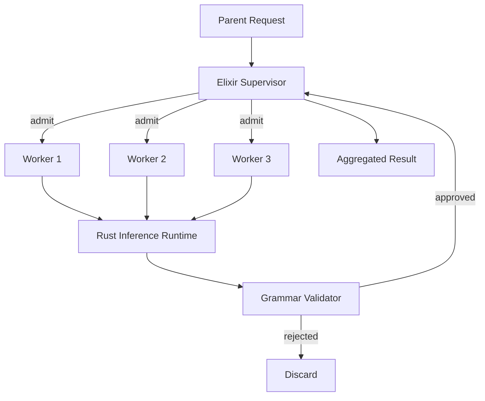

# Sovereign Stack


<p align="center">
  
  
  
  
  
</p>

**Sovereign Stack** is a production-oriented, actor-supervised micro-agent runtime that replaces monolithic agent execution with isolated, bounded, short-lived inference workers. It pairs a zero-dependency Rust command grammar with an Elixir/OTP supervisor and a Rust inference runtime. The design is deliberately constrained: no Python, no TypeScript, no shared mutable prompt buffers, and no silent validation failures.

This repository contains the v1.0.0 production foundation. Continuous integration is green on `main`. The core contracts, supervision tree, and parsing pipeline are complete and tested. Live llama.cpp integration remains an explicit next step, not a claimed capability.

---

## Architecture

The system is organized around three independent agents that meet at a single integration barrier.



| Agent | Ownership | Language | Responsibility |
|-------|-----------|----------|----------------|
| Agent 1 | `supervisor/`, `routing/` | Elixir/OTP | DynamicSupervisor, lifecycle, admission, cancellation |
| Agent 2 | `runtime/`, `ffi/` | Rust + C ABI | Ephemeral inference sessions, budgets, mock backend |
| Agent 3 | `grammar/`, `validation/` | Elixir | GBNF contracts, rejection of malformed output |

The supervisor never holds model weights. Each worker receives an immutable context slice, executes under a finite deadline and token budget, and terminates. Invalid output is rejected before it can reach the parent. Stale messages from already-terminated workers are discarded.

---

## Lifecycle

Every worker follows a strict state machine. Transitions are explicit. Deterministic validation failures do not trigger automatic restarts.

```
CREATED → ADMITTED → RUNNING → VALIDATING → COMPLETED → TERMINATED
                              ↘
                           FAILED → CANCELLED → TERMINATED
```

| State | Meaning | Next |
|-------|---------|------|
| CREATED | Process started, no work yet | ADMITTED |
| ADMITTED | Passed depth and fan-out checks | RUNNING |
| RUNNING | Inference or mock generation in progress | VALIDATING or FAILED |
| VALIDATING | Output checked against grammar contract | COMPLETED or FAILED |
| COMPLETED | Valid result delivered | TERMINATED |
| FAILED | Contract or runtime error | CANCELLED |
| CANCELLED | Explicit cancel or deadline | TERMINATED |
| TERMINATED | Process stopped, resources released | — |

---

## Invariants

The following invariants are enforced in code and covered by tests where noted.

| ID | Invariant | Status |
|----|-----------|--------|
| I1 | No worker exceeds its assigned recursion depth | Enforced in supervisor |
| I2 | No parent exceeds its child fan-out budget | Enforced in admission |
| I3 | Every worker reaches exactly one terminal state | Enforced in worker |
| I4 | A terminated worker cannot publish a new valid result | Stale messages discarded |
| I5 | Invalid grammar output never enters the approved channel | Validator rejects |
| I6 | Worker cancellation cannot corrupt shared inference state | Atomic flag; no shared KV |
| I7 | KV-cache references never outlive their allocation | Not applicable in mock |
| I8 | Every task has a finite deadline and bounded budget | Enforced in both layers |
| I9 | Parent termination triggers defined child cancellation | `cancel_all` implemented |
| I10 | No unvalidated output mutates supervisor state | Validation before accept |

---

## Components

### sovereign-cmd

Zero-dependency Rust crate. Zero-copy lexer, hand-written parser, and execution contract for the sovereign command grammar. The grammar is llama.cpp compatible (`commands.llama.gbnf`).

Contract rules currently enforced:

- `WRITE` to a memory address below `0x1000` is rejected.
- `RUN` must be a path under `/opt/sovereign/bin/`.

```bash
cd sovereign-cmd
cargo test
cargo run --bin sovereign-cmd
```

### codex/supervisor

Elixir/OTP application. `DynamicSupervisor` for ephemeral workers. Admission control with configurable maximum active workers and recursion depth. Message envelopes with stale-message discard. Deadline timers. Cancellation propagation.

```bash
cd codex/supervisor
mix compile
mix test
```

### codex/runtime

Rust inference worker. `InferenceWorker` with atomic cancellation, token budget, and deadline. Deterministic `MockBackend` for testing without GPU. Documented C ABI surface for future llama.cpp binding. Unit tests cover budget respect and cancellation.

```bash
cd codex/runtime
cargo test
cargo build --release
```

### codex/grammar

Deterministic validators for boolean, enum, and command contracts. Invalid output is rejected with structured evidence. The validator is the gate that implements invariant I5.

---

## Repository Layout

```
sovereign-stack/
├── assets/header.svg
├── .github/workflows/ci.yml
├── Makefile
├── LICENSE
├── README.md
├── sovereign-cmd/
│   ├── Cargo.toml
│   ├── src/
│   │   ├── lib.rs
│   │   ├── ast.rs
│   │   ├── lexer.rs
│   │   ├── parser.rs
│   │   ├── contract.rs
│   │   ├── error.rs
│   │   └── main.rs
│   ├── tests/basic.rs
│   └── grammar/commands.llama.gbnf
└── codex/
    ├── supervisor/
    │   ├── mix.exs
    │   └── lib/codex/
    ├── runtime/
    │   ├── Cargo.toml
    │   └── src/
    └── grammar/
        └── src/validator.ex
```

---

## Build and Test

A top-level Makefile drives both crates.

```bash
make test    # cargo test (both) + mix compile
make build   # cargo build --release (both)
make clean
```

Continuous integration runs on every push to `main`:

- Rust: `cargo test` and `cargo build --release` for `sovereign-cmd` and `codex/runtime`
- Elixir: `mix compile` for the supervisor

The latest run is green. See `.github/workflows/ci.yml`.

---

## Design Constraints

The following are forbidden by contract and absent from the dependency tree:

- Python
- TypeScript or JavaScript orchestration
- React or Next.js
- Unbounded recursion
- Shared mutable prompt buffers
- Silent grammar validation failures
- Fake benchmarks or simulated production results presented as measured

KV-cache reuse across workers is not assumed. The mock backend does not share writable state. Any future llama.cpp integration must prove ownership, lifetime, and concurrency before enabling prefix reuse. Until that proof exists, reuse is disabled.

---

## What Is Not Claimed

This foundation does not include:

- A live Port or NIF bridge between Elixir and Rust
- Constrained decoding against a real llama.cpp model
- Measured p50/p95/p99 latencies on hardware
- The original Grok Bot package (`ternary6502`, full earlier `micro-agents` tree, `grammar-decode` results)

Those items remain out of tree or explicitly deferred. No performance number in this document is a measured production result.

---

## License

GNU Affero General Public License v3.0 or later (AGPL-3.0-only).

See [LICENSE](LICENSE) for the full text.

---

## Version

**v1.0.0** — production foundation. CI passing. Header image present. Ready for tag.
