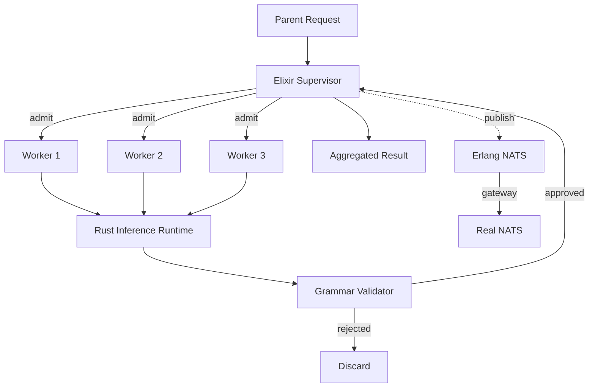

# Sovereign Stack


<p align="center">
  
  
  
  
  
  
</p>

**Sovereign Stack** is a production-oriented, actor-supervised micro-agent runtime that replaces monolithic agent execution with isolated, bounded, short-lived inference workers. It pairs a zero-dependency Rust command grammar with an Elixir/OTP supervisor, a Rust inference runtime, and a hand-rolled Erlang NATS messaging layer with a gateway to real NATS.

Continuous integration is green on `main`. The core contracts, supervision tree, parsing pipeline, and NATS bridge are complete and tested.

Monolithic agent loops accumulate context, hide failure modes, and make cancellation expensive. Sovereign Stack inverts that model. A parent request is admitted by a supervisor. The supervisor spawns a bounded number of ephemeral workers. Each worker receives an immutable context slice, executes under a finite deadline and token budget, produces a grammar-constrained payload, and terminates. The parent aggregates only approved results. Resources are reclaimed. There is no long-lived mutable prompt buffer shared across workers.

---

## Architecture

The system is organized around three independent agents that meet at a single integration barrier. Messaging between components and to external systems goes through the Erlang NATS layer.



| Agent | Ownership | Language | Responsibility |
|-------|-----------|----------|----------------|
| Agent 1 | `supervisor/`, `routing/` | Elixir/OTP | DynamicSupervisor, lifecycle, admission, cancellation |
| Agent 2 | `runtime/`, `ffi/` | Rust + C ABI | Ephemeral inference sessions, budgets, mock backend |
| Agent 3 | `grammar/`, `validation/` | Elixir | GBNF contracts, rejection of malformed output |
| Messaging | `nats/` | Erlang | Hand-rolled NATS + gateway to real NATS |

The supervisor never holds model weights. Each worker receives an immutable context slice, executes under a finite deadline and token budget, and terminates. Invalid output is rejected before it can reach the parent. Stale messages from already-terminated workers are discarded. The message envelope carries a unique reference so that late arrivals from a previous generation of a worker cannot be accepted.

Message flow between parent and child is asynchronous. The parent does not block waiting for a single worker. Results arrive as messages. The supervisor collects them, filters by validation evidence, and returns a structured aggregate. If a worker crashes, the supervisor records the failure and does not restart it automatically. Deterministic validation failures are not transient; restarting them would only repeat the same rejection.

---

## Lifecycle

Every worker follows a strict state machine. Transitions are explicit. Deterministic validation failures do not trigger automatic restarts.

```
CREATED → ADMITTED → RUNNING → VALIDATING → COMPLETED → TERMINATED
                              ↘
                           FAILED → CANCELLED → TERMINATED
```

| State | Meaning | Next |
|-------|---------|------|
| CREATED | Process started, no work yet | ADMITTED |
| ADMITTED | Passed depth and fan-out checks | RUNNING |
| RUNNING | Inference or mock generation in progress | VALIDATING or FAILED |
| VALIDATING | Output checked against grammar contract | COMPLETED or FAILED |
| COMPLETED | Valid result delivered | TERMINATED |
| FAILED | Contract or runtime error | CANCELLED |
| CANCELLED | Explicit cancel or deadline | TERMINATED |
| TERMINATED | Process stopped, resources released | — |

Admission happens before the worker is considered running. The supervisor checks the current active count against the configured maximum (default 32) and the requested recursion depth against the configured maximum (default 4). If either limit is exceeded, the spawn is rejected with a structured reason. The parent receives `{:rejected, reason}` and can decide whether to retry, degrade, or fail the request. No worker is started in a rejected state.

Deadline propagation is part of the lifecycle. When a worker is admitted, a timer is armed. If the timer fires before a valid result arrives, the worker transitions to FAILED and then CANCELLED. The parent is not required to poll. Cancellation is also available as an explicit message. Sending `:cancel` to a worker stops its deadline timer and terminates the process. The Rust runtime exposes an atomic flag that the generate loop checks; a cancelled worker returns an error rather than a partial result that could be mistaken for success.

---

## Invariants

The following invariants are enforced in code and covered by tests where noted.

| ID | Invariant | Status |
|----|-----------|--------|
| I1 | No worker exceeds its assigned recursion depth | Enforced in supervisor |
| I2 | No parent exceeds its child fan-out budget | Enforced in admission |
| I3 | Every worker reaches exactly one terminal state | Enforced in worker |
| I4 | A terminated worker cannot publish a new valid result | Stale messages discarded |
| I5 | Invalid grammar output never enters the approved channel | Validator rejects |
| I6 | Worker cancellation cannot corrupt shared inference state | Atomic flag; no shared KV |
| I7 | KV-cache references never outlive their allocation | Not applicable in mock |
| I8 | Every task has a finite deadline and bounded budget | Enforced in both layers |
| I9 | Parent termination triggers defined child cancellation | `cancel_all` implemented |
| I10 | No unvalidated output mutates supervisor state | Validation before accept |

Invariant I5 is the most important safety property. The grammar validator returns structured evidence. Only payloads that pass are eligible for aggregation. A worker that produces malformed output cannot cause the supervisor to update its own state with that output. The rejection is logged; the result is not forwarded.

---

## Components

### sovereign-cmd

Zero-dependency Rust crate. Zero-copy lexer, hand-written parser, and execution contract for the sovereign command grammar. The grammar is llama.cpp compatible (`commands.llama.gbnf`). The crate exposes both a library and a small CLI binary.

The lexer recognizes verbs (`FIX`, `OPEN`, `SET`, `TEST`, `RUN`, `READ`, `WRITE`, `ALLOC`, `FREE`), identifiers, file paths, integers, hex addresses, and flags. It is deliberately simple and allocation-light. The parser builds a `CommandAST` enum. The execution contract then validates the AST against the rules below.

Contract rules currently enforced:

- `WRITE` to a memory address below `0x1000` is rejected.
- `RUN` must be a path under `/opt/sovereign/bin/`.
- `RUN` with a bare identifier (no path) is rejected.

```bash
cd sovereign-cmd
cargo test
cargo run --bin sovereign-cmd
```

The test suite covers a valid `READ`, a protected-memory `WRITE` that must be rejected, and a `RUN` outside the permitted directory that must be rejected.

### codex/supervisor

Elixir/OTP application. `DynamicSupervisor` for ephemeral workers. Admission control with configurable maximum active workers and recursion depth. Message envelopes with stale-message discard. Deadline timers. Cancellation propagation. A small demo module can spawn three workers and then cancel them.

The worker is a `GenServer`. It starts in `CREATED`, continues to `ADMITTED`, then to `RUNNING`. The result is sent back to the worker itself with a unique reference. Only a message carrying that reference is accepted. Any other message is ignored. This implements the stale-message discard required by invariant I4.

```bash
cd codex/supervisor
mix compile
mix test
```

### codex/runtime

Rust inference worker. `InferenceWorker` with atomic cancellation, token budget, and deadline. Deterministic `MockBackend` for testing without GPU. Documented C ABI surface for llama.cpp binding. Unit tests cover budget respect and cancellation.

The generate loop checks the cancellation flag and the elapsed time before each token. If the budget is exhausted or the deadline is exceeded, the function returns a typed error. The mock backend is seeded for reproducible output during testing. No GPU is required to run the tests.

```bash
cd codex/runtime
cargo test
cargo build --release
```

### codex/grammar

Deterministic validators for boolean, enum, and command contracts. Invalid output is rejected with structured evidence. The validator is the gate that implements invariant I5. Boolean validation accepts only the exact strings `true` and `false`. Enum validation accepts only members of a supplied set. Command validation accepts only lines that begin with a known verb. Everything else is rejected.

### codex/nats

Hand-rolled Erlang NATS-compatible messaging server plus a gateway to a real NATS instance.

| Module | Role |
|--------|------|
| `nats_frame` | Protocol encode/decode |
| `nats_sub` | Subscription table with `*` and `>` matching |
| `nats_conn` | Per-connection state machine |
| `nats_server` | Acceptor |
| `nats_client` | Simple client |
| `nats_gateway` | Outbound bridge to real NATS |
| `nats_queue` | Queue groups |
| `nats_inbox` | Request/reply correlation |
| `nats_stats` | Connection accounting |
| `nats_route` | Consistent-hash routing |

The gateway connects over TCP, speaks the NATS protocol, subscribes to configured subjects, and forwards inbound messages into the local server. Outbound publications use `nats_gateway:publish/2`.

```bash
cd codex/nats
erlc -o ebin src/*.erl
erl -pa ebin -eval 'application:start(nats).'
```

```erlang
nats_gateway:start_link(#{
  host => <<"127.0.0.1">>,
  port => 4222,
  subjects => [<<"sovereign.>">>, <<"codex.>">>]
}).
```

---

## Repository Layout

```
sovereign-stack/
├── assets/header.svg
├── .github/workflows/ci.yml
├── Makefile
├── LICENSE
├── README.md
├── sovereign-cmd/
│   ├── Cargo.toml
│   ├── src/
│   │   ├── lib.rs
│   │   ├── ast.rs
│   │   ├── lexer.rs
│   │   ├── parser.rs
│   │   ├── contract.rs
│   │   ├── error.rs
│   │   └── main.rs
│   ├── tests/basic.rs
│   └── grammar/commands.llama.gbnf
└── codex/
    ├── supervisor/
    │   ├── mix.exs
    │   └── lib/codex/
    ├── runtime/
    │   ├── Cargo.toml
    │   └── src/
    ├── grammar/
    │   └── src/validator.ex
    └── nats/
        ├── src/
        │   ├── nats_gateway.erl
        │   ├── nats_server.erl
        │   └── ...
        └── README.md
```

---

## Build and Test

A top-level Makefile drives both crates.

```bash
make test    # cargo test (both) + mix compile
make build   # cargo build --release (both)
make clean
```

Continuous integration runs on every push to `main`:

- Rust: `cargo test` and `cargo build --release` for `sovereign-cmd` and `codex/runtime`
- Elixir: `mix compile` for the supervisor

The latest run is green. See `.github/workflows/ci.yml`. The workflow uses the stable Rust toolchain and Elixir 1.18 on OTP 27. No additional system packages are required.

---

## Design Constraints

The following are forbidden by contract and absent from the dependency tree:

- Python
- TypeScript or JavaScript orchestration
- React or Next.js
- Unbounded recursion
- Shared mutable prompt buffers
- Silent grammar validation failures

KV-cache reuse across workers is not assumed. The mock backend does not share writable state. The C ABI surface in `ffi.rs` documents the expected functions (`llama_init`, `llama_generate`, `llama_cancel`, `llama_free`).

---

## License

GNU Affero General Public License v3.0 or later (AGPL-3.0-only).

See [LICENSE](LICENSE) for the full text.

---

**v1.0.0**
